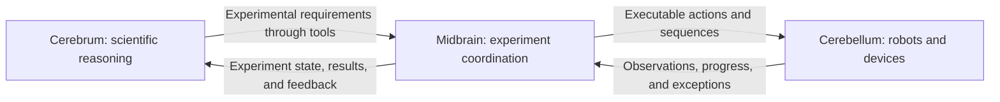

# science-harness — Experiment Infrastructure v0.2

AI4Science Harness is a small, plugin-oriented foundation for scientific Agent organizations and execution Providers. It keeps Agent lifecycle, sessions, native parent-child execution, residency, messaging, and shutdown in DeepSeek Harness while adding configurable organization policy, durable operation records, resource and budget control, result provenance, cancellation, and restart reconciliation.

The repository is intended for community development. A Provider can implement the public `describe / prepare / submit / query / cancel` interface and register through configuration without changing the execution core. The reference integrations include a simulated instrument and a resumable long-running computation. The original first-loop research scenario remains an example application rather than a platform rule.

This release targets one trusted management domain on one machine. It does not claim physical-device safety, distributed high availability, multi-tenant isolation, model-thought recovery, or scientific correctness of model-authored reports. The upstream Harness baseline and local host changes are recorded in [UPSTREAM.json](UPSTREAM.json).

**No license. Free to use.** You may freely use, copy, modify, and redistribute the original AI4Science additions. This permission does not replace the existing licenses and copyright notices of upstream Harness or third-party components. Local validation records do not establish the status of GitHub-hosted CI.

## Project Vision

The core idea behind science-harness is to build an AI for Science system capable of independently carrying out the full research process. Its long-term scope extends from proposing research directions and scientific conjectures to planning studies, designing and executing experiments, adapting to experimental evidence, analyzing results, and writing research papers.

> Research directions and hypotheses → Research plans → Experiment design and execution → Continuous adjustment based on evidence → Analysis and interpretation → Papers and further research.

This process is a continuing feedback loop. An experiment may contradict a hypothesis, reveal an unexpected effect, or suggest a better question. The system should use those observations to revise its plans and pursue the next investigation. Each decision and conclusion should remain connected to the measurements, computational artifacts, methods, and execution history that support it.

### A Three-Layer Research Architecture

The envisioned architecture separates responsibilities into three conceptual layers: **cerebrum, midbrain, and cerebellum**. These names describe scientific reasoning, experiment coordination, and concrete execution. They do not prescribe a fixed number of Agents, processes, or services.

| Layer | Responsibilities | Intended implementation |
|---|---|---|
| **Cerebrum — scientific reasoning** | Propose research directions, formulate hypotheses, develop research plans, design experiments, interpret results, and decide what to investigate next. Submit experimental requirements to the midbrain through tools. | An Agent or a multi-agent organization focused on scientific reasoning and decision-making. |
| **Midbrain — experiment coordination** | Translate scientific requirements into individual executable actions or operation sequences. Monitor execution, coordinate resources, respond to observed conditions, and return progress, exceptions, and results to the cerebrum. | An Agent or a multi-agent organization connecting scientific intent to available execution capabilities. |
| **Cerebellum — concrete execution** | Perform actions in the physical experiment environment and return observations. Robotic capabilities may include navigation, path planning, and dexterous manipulation; other capabilities may include instruments, sensors, actuators, and IoT devices. | Device controllers, robot systems, tools, and capability plugins. Computational and simulation Providers can serve the corresponding execution role for nonphysical experiments. |

The basic information flow is:



The midbrain would observe execution as it unfolds and adjust the operation sequence within the approved experimental scope. Changes that affect the scientific question, experimental design, or interpretation would return to the cerebrum for a research decision. Concrete controllers would remain responsible for device-specific behavior and local protection; model reasoning would coordinate those capabilities through explicit interfaces.

### Flexible Multi-Agent Organizations

Each reasoning layer may itself contain multiple Agents. For example, a main scientific Agent could coordinate several research subagents, each investigating a different hypothesis or method. Those research subagents could create their own midbrain Agents to organize experiments. Midbrain Agents from different research branches could communicate through authorized relationships, exchange result references, and coordinate access to shared execution resources.

Organizations should form around the problem being studied. Some projects may need a single researcher and one Provider; others may need several research branches, shared analysis specialists, or multiple experiment coordinators. The architecture should allow different participant counts, delegation structures, and collaboration patterns without requiring a new core implementation for each arrangement. The three-layer model provides a way to assign responsibilities while leaving those organizational choices open.

### A Platform Built Through Plugins

science-harness is intended to be both an architectural foundation and an extensible platform. Research strategies, role configurations, analysis methods, reporting tools, and execution capabilities should be developed as focused plugins. Contributors should be able to improve a scientific method independently of the device adapters that execute its experiments.

The cerebellum layer particularly depends on community adaptation. Different robots, dexterous hands, navigation systems, laboratory instruments, and IoT devices require different interfaces and operating guarantees. A growing collection of independently developed and validated capability plugins could make those resources available to research systems built on the same foundation. Each adapter must describe what it accepts, what it produces, what completion means, and how it handles interruption or uncertainty.

### Persistent Research and Accountable Autonomy

Research records must outlive individual conversations and Agent instances. A new authorized participant should be able to understand the task, inspect earlier operations and results, and continue managing unresolved work. Failed attempts, contradictory evidence, uncertain outcomes, and reasons for changing a plan should remain available alongside successful results.

Greater autonomy depends on dependable execution and clear authority. Models can propose research actions and interpret observations, while programs enforce permissions, resource ownership, budgets, operation identity, and lifecycle rules. More capable production models can improve research decisions while using the same execution and accountability mechanisms.

Infrastructure v0.2 builds on configurable organizations, authorized cross-branch result exchange, a public Provider interface, and recoverable execution records. It adds durable experiment requirements, evidence-linked action decisions, program-driven feedback, explicit review and execution closure. The full autonomous research cycle, adaptive robotic experimentation, navigation and dexterous manipulation integrations, and scientific paper generation described in this vision remain broader goals requiring their own implementations and evidence. Community progress should connect those goals to reproducible examples and validated capabilities, while keeping the scope of each release explicit.

## Quick Start

You need Node.js 22.19+ (local validation used 22.23.1), pnpm 11.19.0, Python 3, and a C++ build toolchain. The validated platform is macOS arm64; other operating systems have not been verified.

Run these commands from the repository root:

```sh
python3 integrations/ai4science/platform/setup.py
python3 integrations/ai4science/platform/install.py --home .ai4science/home --config integrations/ai4science/platform/examples/local.config.json
python3 integrations/ai4science/platform/manage.py --home .ai4science/home create --project example --budget 10000
python3 integrations/ai4science/platform/manage.py --home .ai4science/home describe --project example
python3 integrations/ai4science/platform/manage.py --home .ai4science/home start --project example --provider compute --key compute-1 --input integrations/ai4science/platform/examples/compute-input.json --wait
python3 integrations/ai4science/platform/manage.py --home .ai4science/home status --project example
```

The setup script installs dependencies from the two existing lockfiles, builds the host's native system addon, and builds type declarations. The application entry remains `dsh --profile ai4science`; `manage.py` launches it from source. Configuration determines project and device directories. Git ignores generated example data.

## Capabilities

- Configure roles, instructions, models, tools, creation permissions, participant limits, and delegation depth. Create participants at runtime through native Harness mechanisms.
- Exchange persistent result references and correlated replies between participants with different real parents, after both parents independently authorize the relationship. Preserve the original sender, exact live-instance checks, and default denial.
- Store projects, request identities, resources, budgets, operation states, results, and task facts in one SQLite execution database. Repeated requests return the original operation across restarts.
- Use two independent reference Providers: a shared simulated instrument and a hash computation that continues in chunks. Independent device journals record actual execution to detect duplicate actions.
- Wait in program code, request cancellation, reconcile after restart, verify result integrity, and export artifacts. Keep the original first-loop research scenario as an example application.

## Experiment Collaboration and Feedback

An experiment now connects its goal, method version, declared inputs, permitted actions, operation history, assessments and completion artifacts. It uses the existing execution database and Provider interface. Agent creation, delegation, messaging and continuation still belong to Harness.

The [sampling example](integrations/ai4science/platform/scenes/sampling.ts) starts with four actual simulated readings, checks their completeness, and selects one permitted supplementary acquisition when the required six readings are not yet available. Each adjustment records its rationale and evidence references before dispatch. The domain plugin owns that completeness rule and execution report; the platform checks provenance and lifecycle rather than scientific conclusions.

Run the full keyless example through separate real CLI processes:

```sh
python3 integrations/ai4science/platform/experiment-check.py --output .ai4science/experiment-demo
```

The check installs its own profile and an independent local-job Provider, exercises the sampling loop, reconnects to computation after the submitting process exits, and observes actual worker cancellation. It leaves requests, decisions, assessment output, execution and Provider databases, and exact command/stdout/stderr records in the output directory. `results.json` lists assertions; `commands.json` contains the actual IDs and responses. See [the operating guide](first-loop.md#experiment-v02) for individual commands.

The same recipe also runs through two native Harness organizations configured in [compact](integrations/ai4science/platform/examples/sampling.compact.organization.json) and [hierarchical](integrations/ai4science/platform/examples/sampling.hierarchical.organization.json) JSON files. Their `teams-probe/script` model identifiers belong to the deterministic test fixture; production compositions must configure an installed model adapter. The test scripts use returned tool data and actual delegated identities, and do not supply precomputed Provider outcomes.

```sh
pnpm exec vitest run --config integrations/ai4science/platform/vitest.config.ts integrations/ai4science/platform/experiment-organizations.spec.ts --reporter=verbose
```

Use `engine.experiments` from [the public platform exports](integrations/ai4science/platform/index.ts), or the native `experiment_create`, `experiment_act`, `experiment_wait`, `experiment_status`, `experiment_claim`, `experiment_escalate`, `experiment_resolve`, `experiment_finish` and `experiment_cancel` tools. Role tool allowlists and Provider grants continue to apply. A bounded worker should receive `experiment_act`, not unrestricted `execution_submit`; the trusted operator and SDK remain able to manage standalone operations.

This release accepts a finite catalog of exact action inputs with per-action counts, a total operation limit and an experiment budget. It does not compile a workflow or accept arbitrary parameter changes. An adjustment outside that catalog blocks new experiment actions for controller review; changing requirements requires a new experiment. A live controller claim is not restored from disk. Provider version/configuration fingerprints are pinned per experiment and exposed in status; a changed binding blocks additional actions. Waits query Providers in program code and return meaningful progress, a decision point or a timeout. They do not keep asking the model to poll.

Execution closure, domain assessments and scientific conclusions remain separate. Generic `experiment_finish` verifies settled operations and sourced artifacts; it does not enforce a sampling policy. The sampling plugin's `sampling_finish` additionally checks its own completeness requirement. The existing dashboard continues to manage operations; experiment commands and decision history are currently exposed through CLI/tools/SDK only.

**Database upgrade:** opening a v0.1 execution database migrates schema 1 to schema 2 in one transaction, preserving completed operations, budgets and result links. Older platform code refuses schema 2; there is no automatic downgrade. Keep the original execution and device directories. Neither migration nor an experiment claim revives a previous Agent's communication authorization.

## Independently Running Execution Plugin

The optional [local-job Provider](integrations/ai4science/external-job/provider/src/index.mjs) runs a fixed SHA256 computation in an external worker, supervised independently of Harness. Accepted work continues when the submitting CLI exits or stops querying. A new authorized controller can find the original job, inspect its actual progress and exit state, request cancellation, and export its results.

The Provider and its public SDK are delivered as separate local installation packages. The SDK is compiled from the existing public interface; no organization, communication, execution-core, or SDK protocol changes are required. The packages use plain ESM and declarations, and installation is verified outside the source checkout. They are local development artifacts, not npm registry releases. The usage permission below applies to the original AI4Science additions.

```sh
python3 integrations/ai4science/external-job/build.py --output .ai4science/local-job-packages
python3 integrations/ai4science/external-job/install.py --packages .ai4science/local-job-packages --directory .ai4science/local-job
python3 integrations/ai4science/platform/install.py --home .ai4science/local-job-home --config .ai4science/local-job/config.json
python3 integrations/ai4science/platform/manage.py --home .ai4science/local-job-home create --project external --budget 20000000
python3 integrations/ai4science/platform/manage.py --home .ai4science/local-job-home start --project external --provider local-job --key job-1 --input .ai4science/local-job/input.json
python3 integrations/ai4science/platform/manage.py --home .ai4science/local-job-home status --project external
```

Build and installation directories must be new. The generated deployment JSON is editable, and the installed Provider module is loaded through the existing public registration path. Use the returned operation ID with the existing `query`, `wait`, `cancel`, and `export` commands; see [the operating guide](first-loop.md#external-local-job).

```sh
python3 integrations/ai4science/external-job/check.py --output .ai4science/external-check --regressions
```

This check builds both packages, installs them offline in a clean external directory, verifies standalone TypeScript declarations, runs actual CLI operations, injects process failures, exercises a scripted Agent through platform tools, and optionally runs retained v0.1 regressions. It makes no real-model requests.

The supervisor owns a live worker handle; reconnecting clients never signal a PID loaded from disk. A durable job ID, launch ticket, operation mapping and OS-released ownership lock distinguish an active job from an uncertain one. Cancellation is recorded before it is acted on, and terminal results are published only after worker exit is observed. A startup deadline bounds unconfirmed launches. Supervisor loss, missing executables and uncertain launch outcomes do not cause automatic replay or resource release. Machine reboot, continuation after supervisor failure, Windows/Linux operation, physical devices and power-loss durability remain unverified or unsupported.

## Copyable Provider Example

Start with [provider-example](integrations/ai4science/example-plugin/provider/) when learning the plugin interface. It performs a small, domain-neutral transformation, `output = value * scale + offset`, and publishes JSON, CSV, and a summary. For input `[1, 2, 3]`, scale `2`, and offset `1`, the result is `[3, 5, 7]` with mean `5`.

```sh
python3 integrations/ai4science/example-plugin/build.py --output .ai4science/example-packages
python3 integrations/ai4science/example-plugin/install.py --packages .ai4science/example-packages --directory .ai4science/example-plugin
python3 integrations/ai4science/platform/install.py --home .ai4science/example-home --config .ai4science/example-plugin/config.json
python3 integrations/ai4science/platform/manage.py --home .ai4science/example-home create --project example-plugin --budget 20
python3 integrations/ai4science/platform/manage.py --home .ai4science/example-home start --project example-plugin --provider example --key example-1 --input .ai4science/example-plugin/input.json
```

Use fresh build and installation directories. The example and SDK install as separate packages; the Provider imports no platform internals or research scenario. It uses the existing management commands for query, cancel and export.

To create your own adapter, copy the `provider/` directory, change its package name, and follow the `CUSTOMIZE HERE` comments:

| File | What to adapt |
|---|---|
| [workload.mjs](integrations/ai4science/example-plugin/provider/src/workload.mjs) | Input Schema, validation and business computation. |
| [index.mjs](integrations/ai4science/example-plugin/provider/src/index.mjs) | Capability description, resource/budget requirements, artifact formats and supported lifecycle semantics. |
| [provider.test.mjs](integrations/ai4science/example-plugin/provider/test/provider.test.mjs) | Expected outputs and checks for identity, deduplication, failed publication and cancellation. |
| [package.json](integrations/ai4science/example-plugin/provider/package.json) | Package identity and version; update `PROVIDER_VERSION` alongside behavior changes. |

The tests travel with the package and run with `node --test test/provider.test.mjs` after installation. A version change requires a compatible journal strategy; this example rejects a changed persisted configuration rather than silently reusing records under different behavior.

```sh
python3 integrations/ai4science/example-plugin/check.py --output .ai4science/example-check
```

This checks the installed package outside the repository, then uses the actual platform CLI to submit, query, deduplicate and export a result. Provider-side execution records confirm that retries do not redo the computation.

This is a short synchronous starter. It cannot interrupt an operation: completed work rejects cancellation, and unconfirmed work reports unsupported cancellation while retaining its unknown state. It does not simulate cancellation or recovery success. For independently running or interruptible jobs, use the existing [local-job example](integrations/ai4science/external-job/provider/) and validate that lifecycle separately. No core API, organization policy or execution framework is added by this example.

## Local Dashboard

A lightweight browser workspace provides project switching, execution status, budget usage, Provider details, run submission, cancellation requests, and verified artifact previews/downloads. It reads the existing execution journal and calls the existing execution APIs. No browser-side task engine or second database is introduced.

The **About the project** link opens `/about`, an English introduction with a large animated architecture diagram. It illustrates configurable Agent organizations, three responsibility layers, authorized cross-branch collaboration, execution feedback, and state/evidence/policy across the layers. The conceptual walkthrough includes six selectable stages, node details, pause/play, an expanded view, and reduced-motion support; it never starts Agents or operations. It separates implemented infrastructure from the long-term research vision and links to the example plugin. This static page contains no project state and can be read without the workspace credential; execution APIs remain authenticated.

After installing a management profile, start its dashboard:

```sh
python3 integrations/ai4science/platform/manage.py --home .ai4science/home serve --port 8787
```

Open the launch link printed by the command. The server binds only to `127.0.0.1` and generates fresh access credentials for each run. Do not share the launch link. Control API requests require its bearer credential; an HttpOnly, same-site session cookie is accepted only for native artifact downloads. Project and Provider permissions remain those in the management configuration. This is a local operator interface, not a multi-user or publicly hosted service.

For a fresh demonstration backed by actual simulated operations:

```sh
python3 integrations/ai4science/platform/dashboard-demo.py --directory .ai4science/dashboard-demo
python3 integrations/ai4science/platform/manage.py --home .ai4science/dashboard-demo/home serve --port 8787
```

The demo creates completed measurements, computation results, a cancelled operation and a running computation through the CLI. These are real executions of synthetic Providers, not invented dashboard rows. Use a new demo directory each time.

The server holds the existing single-controller lock while running, so use its interface or stop it before opening another CLI controller for the same domain. Background monitoring queries active operations independently of page refresh; unknown operations require explicit reconciliation. Closing the browser does not stop management. Ctrl+C stops the server and management, without claiming that equipment has stopped. Independent external jobs retain their own lifecycle.

`--refresh-ms` sets the server's monitoring interval (100–60000 ms; default 1000). Browser preview/download is limited to 16 MiB per artifact; use the CLI for larger files. Input requests are limited to 1 MiB. The interface includes loading, empty, error and responsive layouts. See [dashboard.ts](integrations/ai4science/platform/dashboard.ts) for the adapter and [dashboard/](integrations/ai4science/platform/dashboard/) for the dependency-free frontend.

## Development Entry Points

| Development task | Entry point |
|---|---|
| Integrate a device or computation capability | [Public SDK](integrations/ai4science/platform/sdk.ts), [Provider test utilities](integrations/ai4science/platform/testing.ts) |
| Explore reference Providers | [Simulated instrument](integrations/ai4science/platform/providers/instrument.ts), [long computation](integrations/ai4science/platform/providers/compute.ts) |
| Change the organization | [Role configuration and validation](integrations/ai4science/platform/organization.ts), [example configurations](integrations/ai4science/platform/scenes/) |
| Compose the host plugin | [platform/plugin.ts](integrations/ai4science/platform/plugin.ts) |
| Manage persistent execution and results | [execution.ts](integrations/ai4science/platform/execution.ts), [artifacts.ts](integrations/ai4science/platform/artifacts.ts) |
| Understand architecture, permissions, and lifecycle | [architecture.md](architecture.md) |
| Run operations and the first-loop example | [first-loop.md](first-loop.md) |

A Provider module exports `createProvider(config)`, depends only on the public `sdk.ts`, and implements `describe / prepare / submit / query / cancel`. Register it by adding its module path and parameters to the deployment JSON; no core edit is required. Provider parameters and scientific research stages belong outside the execution core.

## Testing and Contributions

```sh
python3 integrations/ai4science/platform/check.py --output .ai4science/check-01
```

This command requires no model credentials. It runs infrastructure tests, existing communication and permission tests, minimum-plugin tests, Teams tests, first-loop boundary tests, and relevant upstream regressions. It also runs acceptance checks across separate processes through the actual CLI. Use a fresh output directory for each run. Results are written there; runtime data is not committed to Git. GitHub CI stages regular evidence files before upload, excludes dependency directories and symbolic links, and includes a manifest of file sizes and SHA256 hashes. Failed tests retain any records produced before failure.

The v0.2 verification record is [validation/experiments-v0.2.json](validation/experiments-v0.2.json). It identifies the exact source fingerprints, local commands and limitations; raw local evidence is generated by the commands above. No model-quality evaluation was performed.

The original v0.1 delivery passed 36 infrastructure tests and 237 retained regressions (273 total), plus 29 actual CLI commands and 25 assertions. Complete historical evidence remains in the delivery ZIP. The source repository includes a [public summary](validation/v0.1.json), without sessions containing local paths, device databases, or personal configuration. A GitHub workflow configuration alone is not evidence that remote checks have passed.

When submitting a change, describe the problem, implementation, and checks actually executed. Provider changes need independent device execution records and tests for duplicate requests, cancellation, and recovery. Permission changes must retain negative tests. Do not present scripted responses as real-model execution or use scientific conclusion quality as an infrastructure acceptance requirement. Community code contributions should wait until the license is selected; no CLA or contributor licensing terms have been established.

## Scope and Limitations

This version supports one trusted management domain on one machine, with one effective controller per device scope. It can retain multiple projects, but each active Harness organization is associated with one project. The built-in instrument and chunked compute Providers advance local work when queried and pause otherwise. The separately installed local-job Provider executes independently of queries.

An `unknown` operation retains its resources and budget and is never automatically replayed. The full conservative budget is charged at registration, with no automatic refund after cancellation. Closing an Agent, plugin, or CLI does not prove that a device has stopped. A permanently hung adapter requires external process termination followed by reconciliation after restart. Physical devices, multi-tenancy, distributed high availability, model-thought recovery, and malicious-plugin isolation are outside this version's verified scope.

## Upstream and Licensing

The Harness baseline is pinned to `ddefc45fbc7f8e46dd73185e68295696d1297887` (`0.1.6-alpha.2`). The host is modified: the repository source already includes the [complete host patch](patches/harness-ai4science-v0.1.patch). Do not apply it again. [UPSTREAM.json](UPSTREAM.json) records the baseline, affected files, and patch hash.

The upstream MIT license and DeepSeek copyright notice remain in [LICENSE](LICENSE). Third-party licenses remain in their component directories. The original AI4Science additions are provided with **no license** and are free to use, copy, modify, and redistribute. See the [usage statement](integrations/ai4science/LICENSE). Upstream and third-party license requirements continue to apply to their respective code.

## Following Harness Upstream

The repository tracks DeepSeek Harness's `master` branch through a read-only `upstream` remote. [UPSTREAM.json](UPSTREAM.json) is the single current host-version record; plugin configuration, package examples and validation read that pin. Historical validation files retain the revisions they actually tested.

```sh
python3 integrations/ai4science/platform/upstream.py check
python3 integrations/ai4science/platform/upstream.py prepare --directory ../science-harness-upstream-next
```

`check` binds or verifies the upstream remote, disables pushes to it, fetches its configured branch, and reports commits beyond the pinned baseline. When updates exist, `prepare` requires a clean checkout and creates a separate integration branch/worktree with an uncommitted merge. It leaves the caller's branch unchanged. Maintainers resolve conflicts, port the small host extension, regenerate its review patch, update the pin and run the platform and external-job checks before promoting the merge. Upstream publishing workflows are not automatically adopted into this project's CI.

The current intake includes Harness `0.1.6-alpha.2` at `ddefc45fbc7f8e46dd73185e68295696d1297887`, incorporating 1,970 upstream commits after the previous pin. Session V3 and execution schema 2 remain unchanged. The local extension uses the new native continuable capacity control (`maxActiveSubagents`, default 8) and awaited Agent initialization. Cross-branch cold delivery respects capacity, and revoked authority cannot pass the final synchronous acceptance check after asynchronous initialization. Loader reconfiguration now waits on the plugin Fiber before checking readiness. Existing completed operations, experiment records, budgets and result hashes were checked using records created by the previous checkout, without replaying work. See [the upgrade validation](validation/upstream-0.1.6.json).

After updating source, rerun `platform/setup.py` to install the frozen dependencies and build the current native addon. Existing external deployment files must explicitly update their `baseline` to the new pin. Keep the original device directories and exact Provider versions for unresolved operations; changing the host pin does not restore old Agent authorization or permit a device-version mismatch. The external local-job Provider is now `0.1.1`, including a bounded SQLite bootstrap-lock wait exposed by the upgrade regression. Freshly built package manifests carry the host pin used by their deployment example.

The platform's role counts and delegation permissions do not override the host's independent `maxActiveSubagents` and `maxDepth` limits. Configure host capacity explicitly for larger organizations. Science-result project/pair settings are captured when the host extension starts; changing them requires restarting that extension and establishing fresh consent. This intake preserves the community workflow and does not enable upstream release or repository-administration workflows. Upstream desktop, browser and other unrelated surfaces are included as source but are outside this project's local acceptance scope.
