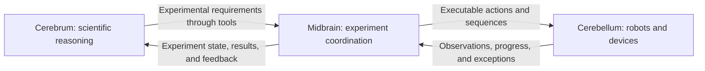

# science-harness — 实验基础设施 v0.2

[English](README.md) | 中文

AI4Science Harness 是一个轻量、面向插件的基础底座，用于承载科学的 agent（智能体）组织与执行提供方。它把 agent 生命周期、会话、原生父子执行、常驻、消息与关闭流程继续留在 DeepSeek Harness 中，同时补上可配置的组织策略、持久的操作记录、资源与预算控制、结果来源追溯、取消以及重启对账。

本仓库面向社区开发。一个提供方可以实现公开的 `describe / prepare / submit / query / cancel` 接口，并通过配置完成注册，无需改动执行内核。参考集成包含一个模拟仪器和一项可恢复的长时计算。最初的 first-loop 科研场景保留为示例应用，而不是平台规则。

本版本面向单机上的一个可信管理域。它不承诺物理设备安全、分布式高可用、多租户隔离、模型思考过程恢复，也不保证模型撰写报告的科学正确性。上游 Harness 基线与本地宿主改动记录在 [UPSTREAM.json](UPSTREAM.json) 中。

**无许可证，可自由使用。** 你可以自由使用、复制、修改和再分发 AI4Science 原创新增的部分。该许可不替代上游 Harness 或第三方组件既有的许可证与版权声明。本地验证记录不能证明 GitHub 上 CI 的运行状态。

## 项目愿景

science-harness 的核心目标是构建一个能够独立完成完整研究流程的 AI for Science（科学人工智能）系统。它的长期范围从提出研究方向与科学猜想，延伸到研究方案规划、实验设计与执行、根据实验证据调整、结果分析与解读，直至撰写研究论文。

> 研究方向与假设 → 研究方案 → 实验设计与执行 → 基于证据持续调整 → 分析与解读 → 论文与后续研究。

这个过程是一个持续运转的反馈回路。一次实验可能推翻某个假设、揭示意料之外的现象，或者指向一个更好的问题。系统应当利用这些观察修订自己的计划，并推进下一轮探索。每一项决策与结论都应当与其支撑证据保持关联：测量数据、计算产物、方法与执行历史。

### 三层研究架构

设想的架构把职责划分为三个概念层：**大脑（cerebrum）、中脑（midbrain）和小脑（cerebellum）**。这三个名字分别对应科学推理（reasoning）、实验协调与具体执行。它们不规定 agent、进程或服务的具体数量。

| 层次 | 职责 | 预期实现方式 |
|---|---|---|
| **大脑（cerebrum）：科学推理** | 提出研究方向、形成假设、制定研究方案、设计实验、解读结果，并决定下一步研究什么。通过工具向中脑提交实验需求。 | 一个聚焦科学推理与决策的 agent，或由多个 agent 组成的组织。 |
| **中脑（midbrain）：实验协调** | 把科学需求翻译成单条可执行动作或操作序列。监控执行、协调资源、响应观察到的状况，并把进度、异常与结果回传给大脑。 | 一个把科学意图与可用执行能力连接起来的 agent，或多 agent 组织。 |
| **小脑（cerebellum）：具体执行** | 在物理实验环境中执行动作并返回观察结果。机器人能力可以包含导航、路径规划与灵巧操作；其他能力可以包含仪器、传感器、执行器与物联网设备。 | 设备控制器、机器人系统、工具与能力插件。对于非物理实验，计算与仿真提供方可以承担对应的执行角色。 |

基本的信息流是：



中脑在执行展开的过程中持续观察，并在已批准的实验范围内调整操作序列。凡是影响科学问题、实验设计或结果解读的变更，都要退回大脑做研究决策。具体控制器仍然对设备相关行为与本地保护负责；模型的推理则通过显式接口来协调这些能力。

### 灵活的多 agent 组织

每个推理层本身都可以包含多个 agent。例如，一个主科学 agent 可以协调若干研究 subagent，各自研究不同的假设或方法；这些研究 subagent 又可以创建自己的中脑 agent 来组织实验。不同研究分支的中脑 agent 可以通过获得授权的关系通信、交换结果引用，并协调对共享执行资源的访问。

组织形式应当围绕所研究的问题来定。有的项目只需要一名研究者加一个提供方；有的项目则需要多条研究分支、共享的分析专家或多名实验协调者。架构应当能容纳不同的参与者数量、委派结构与协作模式，而不必为每一种编排列出一套新的内核实现。三层模型提供了一种划分职责的方式，同时把这些组织选择留给实践者自行决定。

### 通过插件搭建的平台

science-harness 既要成为架构底座，也要成为一个可扩展的平台。研究策略、角色配置、分析方法、报告工具与执行能力都应当以职责聚焦的插件形式开发。贡献者应当能够在不牵动执行其实验的设备适配器的前提下，独立改进某一科学方法。

小脑层尤其依赖社区适配。不同的机器人、灵巧手、导航系统、实验仪器与物联网设备需要不同的接口与运行保障。不断增多、彼此独立开发并经过验证的能力插件，可以把这些资源提供给建立在同一底座上的研究系统。每个适配器都必须说明自己接受什么输入、产出什么结果、完成意味着什么，以及如何处理中断或不确定状态。

### 持久的研究与可问责的自主性

研究记录必须比单次对话和单个 agent 实例活得更久。新获得授权的参与者应当能够理解任务、查看此前的操作与结果，并继续管理尚未解决的工作。失败的尝试、相互矛盾的证据、不确定的结果，以及调整方案的理由，都应当与成功的结果一起保留下来。

更高程度的自主性依赖可靠的执行与清晰的授权边界。模型负责提出研究行动、解释观察结果，程序负责强制执行权限、资源归属、预算、操作身份与生命周期规则。更强的生产模型可以在沿用同一套执行与问责机制的前提下改进研究决策。

基础设施 v0.2 建立在可配置组织、获得授权的跨分支结果交换、公开的提供方接口与可恢复的执行记录之上。它新增了持久的实验需求、与证据关联的行动决策、由程序驱动的反馈，以及明确的评审与执行闭环。本愿景中描述的完整自主研究循环、自适应机器人实验、导航与灵巧操作集成，以及科研论文生成，仍是更大的目标，需要各自的实现与证据。社区进展应当把这些目标连接到可复现的示例和经过验证的能力上，同时明确每个版本的边界。

## 快速开始

环境要求：Node.js 22.19 及以上（本地验证使用 22.23.1）、pnpm 11.19.0、Python 3，以及一套 C++ 构建工具链。已验证的平台是 macOS arm64，其他操作系统尚未验证。

在仓库根目录执行以下命令：

```sh
python3 integrations/ai4science/platform/setup.py
python3 integrations/ai4science/platform/install.py --home .ai4science/home --config integrations/ai4science/platform/examples/local.config.json
python3 integrations/ai4science/platform/manage.py --home .ai4science/home create --project example --budget 10000
python3 integrations/ai4science/platform/manage.py --home .ai4science/home describe --project example
python3 integrations/ai4science/platform/manage.py --home .ai4science/home start --project example --provider compute --key compute-1 --input integrations/ai4science/platform/examples/compute-input.json --wait
python3 integrations/ai4science/platform/manage.py --home .ai4science/home status --project example
```

setup 脚本按现有的两个 lockfile 安装依赖，构建宿主的原生系统插件，并构建类型声明。应用入口仍然是 `dsh --profile ai4science`，`manage.py` 从源码启动它。项目目录与设备目录由配置决定。Git 已忽略生成的示例数据。

## 能力

- 配置角色、指令、模型、工具、创建权限、参与者上限与委派深度；参与者通过 Harness 原生机制在运行时创建。
- 在双方父级各自独立授权之后，不同真实父级下的参与者之间可以交换持久的结果引用与可关联的回复；原始发送者身份、精确的存活实例校验与默认拒绝策略都保持不变。
- 把项目、请求身份、资源、预算、操作状态、结果与任务事实存放在同一个 SQLite 执行库中；重复请求在重启之后仍返回原有操作。
- 内置两个独立的参考提供方：一个共享的模拟仪器，以及一项按分片续算的哈希计算；各自独立的设备日志记录真实执行，用来发现重复动作。
- 在程序代码中等待、请求取消、在重启后对账、校验结果完整性并导出产物；最初的 first-loop 科研场景作为示例应用保留。

## 实验协作与反馈

现在，一个实验把它的目标、方法版本、声明的输入、允许的动作、操作历史、评估与完成产物关联在一起；它沿用现有的执行数据库与提供方接口。agent 的创建、委派、消息与延续仍然归 Harness 负责。

[采样示例](integrations/ai4science/platform/scenes/sampling.ts)先读取四条真实的模拟读数，检查其完整性；当所需的六条读数尚未齐备时，再选择一次允许的补充采集。每次调整在下发之前都会记录自己的理由与证据引用。完整性规则与执行报告由领域插件自己负责；平台校验的是来源与生命周期，而不是科学结论。

通过相互独立的真实 CLI 进程运行完整的无密钥示例：

```sh
python3 integrations/ai4science/platform/experiment-check.py --output .ai4science/experiment-demo
```

该检查会安装自己的 profile 和一个独立的 local-job 提供方，跑通采样循环，在提交进程退出之后重新连上计算任务，并观察真实的 worker 取消。它把请求、决策、评估输出、执行库与提供方库，以及逐条的命令、stdout 与 stderr 记录留在输出目录中。`results.json` 列出各项断言，`commands.json` 记录真实的 id 与响应。单条命令参见[操作指南](first-loop.md#experiment-v02)。

同一套流程还可以跑在两个 Harness 原生组织上，它们分别由 [compact](integrations/ai4science/platform/examples/sampling.compact.organization.json) 与 [hierarchical](integrations/ai4science/platform/examples/sampling.hierarchical.organization.json) 两个 JSON 文件配置。它们使用的 `teams-probe/script` 模型标识属于确定性的 fixture（测试前置数据）；生产环境编排必须配置已安装的模型适配器。测试脚本使用工具返回的数据与真实的委派身份，不预先给定提供方的运行结果。

```sh
pnpm exec vitest run --config integrations/ai4science/platform/vitest.config.ts integrations/ai4science/platform/experiment-organizations.spec.ts --reporter=verbose
```

可以使用[平台公开导出](integrations/ai4science/platform/index.ts)中的 `engine.experiments`，也可以使用原生工具 `experiment_create`、`experiment_act`、`experiment_wait`、`experiment_status`、`experiment_claim`、`experiment_escalate`、`experiment_resolve`、`experiment_finish` 和 `experiment_cancel`。角色工具白名单与提供方授权继续生效。受限的 worker 应当只拿到 `experiment_act`，而不是不受限制的 `execution_submit`；受信任的操作者与 SDK 仍然可以管理独立运行的操作。

本版本只接受一份有限的动作输入清单，其中规定每种动作的次数、总操作上限与实验预算；它不编译工作流，也不接受任意参数变更。清单之外的调整会暂停该实验的新动作，等待控制器评审；需求变更需要新建实验。运行中的控制器认领不会从磁盘恢复。提供方的版本与配置指纹按实验固定，并在状态中暴露；绑定发生变化会阻止后续动作。等待在程序代码中查询提供方，返回有意义的进展、一个决策点或者超时；它不会反复让模型轮询。

执行闭环、领域评估与科学结论三者仍然彼此分离。通用的 `experiment_finish` 只校验已结算的操作与有来源的产物，不负责执行采样策略；采样插件的 `sampling_finish` 会额外检查它自己的完整性要求。现有控制面板继续管理操作；实验命令与决策历史目前仅通过 CLI、工具和 SDK 暴露。

**数据库升级**：打开 v0.1 执行库时，系统会在一个事务内把 schema 1 迁移到 schema 2，并保留已完成操作、预算与结果链接。较旧的平台代码拒绝 schema 2，也不存在自动降级。请保留原有的执行目录与设备目录。迁移和实验认领都不会让此前 agent 的通信授权复活。

## 独立运行的执行插件

可选的 [local-job 提供方](integrations/ai4science/external-job/provider/src/index.mjs)在外部 worker 中运行一段固定的 SHA256 计算，监管进程独立于 Harness。被接受的任务在提交它的 CLI 退出或停止查询之后仍会继续。新的、获得授权的控制器可以找到原任务、查看它的真实进度与退出状态、请求取消并导出结果。

该提供方及其公开 SDK 以两个独立的本地安装包交付。SDK 由现有的公开接口编译而来，不需要改动组织、通信、执行内核或 SDK 协议。两个包使用纯 ESM 与类型声明，安装过程在源码检出目录之外完成验证。它们是本地开发产物，不是发布到 npm registry 的版本。下面的使用许可适用于 AI4Science 原创新增的部分。

```sh
python3 integrations/ai4science/external-job/build.py --output .ai4science/local-job-packages
python3 integrations/ai4science/external-job/install.py --packages .ai4science/local-job-packages --directory .ai4science/local-job
python3 integrations/ai4science/platform/install.py --home .ai4science/local-job-home --config .ai4science/local-job/config.json
python3 integrations/ai4science/platform/manage.py --home .ai4science/local-job-home create --project external --budget 20000000
python3 integrations/ai4science/platform/manage.py --home .ai4science/local-job-home start --project external --provider local-job --key job-1 --input .ai4science/local-job/input.json
python3 integrations/ai4science/platform/manage.py --home .ai4science/local-job-home status --project external
```

构建目录与安装目录必须是全新的。生成的部署 JSON 可以编辑，已安装的提供方模块通过既有的公开注册路径加载。配合现有的 `query`、`wait`、`cancel` 与 `export` 命令使用返回的操作 id；参见[操作指南](first-loop.md#external-local-job)。

```sh
python3 integrations/ai4science/external-job/check.py --output .ai4science/external-check --regressions
```

该检查会构建两个包，在一个干净的外部目录中离线安装它们，校验独立的 TypeScript 声明，运行真实的 CLI 操作，注入进程故障，通过平台工具驱动一个有脚本的 agent，并可选地运行保留的 v0.1 回归用例。它不发起任何真实模型请求。

监管进程持有一个存活的 worker 句柄；重连的客户端绝不会向从磁盘读到的 PID 发送信号。持久的 job id、启动票据、操作映射与由操作系统释放的归属锁，共同区分「仍在运行的任务」与「状态不确定的任务」。取消先记录再执行，终止结果只有在观察到 worker 退出之后才发布。启动阶段设有截止时间，限制未确认的启动。监管进程丢失、可执行文件缺失与启动结果不确定，都不会触发自动重放或资源释放。机器重启、监管进程失败之后的续跑、Windows 或 Linux 上的运行、物理设备与断电持久性，均未经验证或不受支持。

## 可复制的提供方示例

学习插件接口时，可以从 [provider-example](integrations/ai4science/example-plugin/provider/) 开始。它执行的是一个与领域无关的小变换 `output = value * scale + offset`，并输出 JSON、CSV 和一份摘要。输入 `[1, 2, 3]`、scale 为 `2`、offset 为 `1` 时，结果是 `[3, 5, 7]`，均值为 `5`。

```sh
python3 integrations/ai4science/example-plugin/build.py --output .ai4science/example-packages
python3 integrations/ai4science/example-plugin/install.py --packages .ai4science/example-packages --directory .ai4science/example-plugin
python3 integrations/ai4science/platform/install.py --home .ai4science/example-home --config .ai4science/example-plugin/config.json
python3 integrations/ai4science/platform/manage.py --home .ai4science/example-home create --project example-plugin --budget 20
python3 integrations/ai4science/platform/manage.py --home .ai4science/example-home start --project example-plugin --provider example --key example-1 --input .ai4science/example-plugin/input.json
```

请使用全新的构建目录与安装目录。示例与 SDK 作为两个独立的包安装；提供方不导入任何平台内部实现或科研场景。查询、取消与导出沿用现有的管理命令。

要编写自己的适配器，复制 `provider/` 目录、改掉包名，并按 `CUSTOMIZE HERE` 注释修改：

| 文件 | 需要改动的内容 |
|---|---|
| [workload.mjs](integrations/ai4science/example-plugin/provider/src/workload.mjs) | 输入 schema、校验与业务计算。 |
| [index.mjs](integrations/ai4science/example-plugin/provider/src/index.mjs) | 能力描述、资源与预算要求、产物格式以及支持的生命周期语义。 |
| [provider.test.mjs](integrations/ai4science/example-plugin/provider/test/provider.test.mjs) | 预期输出，以及针对身份、去重、发布失败与取消的检查。 |
| [package.json](integrations/ai4science/example-plugin/provider/package.json) | 包的标识与版本；行为变更时同步更新 `PROVIDER_VERSION`。 |

测试随包分发，安装之后用 `node --test test/provider.test.mjs` 运行。版本变更需要配套兼容的日志策略；这个示例会拒绝已经变更的持久化配置，而不是在不同行为下静默复用旧记录。

```sh
python3 integrations/ai4science/example-plugin/check.py --output .ai4science/example-check
```

该检查在仓库之外验证已安装的包，然后通过真实的平台 CLI 提交、查询、去重并导出一份结果。提供方侧的执行记录会确认重试没有重复计算。

这是一个短小的同步入门示例。它无法中断操作：已完成的工作拒绝取消，尚未确认的工作在保留未知状态的同时报告不支持取消。它也不模拟取消成功或恢复成功。需要独立运行或可中断的任务时，请使用现有的 [local-job 示例](integrations/ai4science/external-job/provider/)，并单独验证那条生命周期。这个示例不新增任何内核 API、组织策略或执行框架。

## 本地控制面板

一个轻量的浏览器工作台提供项目切换、执行状态、预算用量、提供方详情、运行提交、取消请求，以及经过校验的产物预览与下载。它读取现有的执行日志，并调用现有的执行 API，不引入浏览器侧的任务引擎或第二个数据库。

**About the project** 链接会打开 `/about`，那是一个带大幅动态架构图的英文介绍页。它展示可配置的 agent 组织、三层职责划分、获得授权的跨分支协作、执行反馈，以及贯穿各层的状态、证据与策略。这个概念导览包含六个可选阶段、节点详情、暂停与播放、展开视图和减弱动效支持；它不会启动任何 agent 或操作。它把已实现的基础设施与长期研究愿景分开陈述，并链接到示例插件。这个静态页面不包含项目状态，不使用工作台凭据也可以阅读；执行 API 仍然需要认证。

安装管理 profile 之后，启动它的控制面板：

```sh
python3 integrations/ai4science/platform/manage.py --home .ai4science/home serve --port 8787
```

打开命令打印出的启动链接。服务端只绑定 `127.0.0.1`，并为每次运行生成全新的访问凭据。请不要分享该启动链接。控制 API 请求需要携带它的 bearer 凭据；HttpOnly 的 same-site 会话 cookie 只在原生产物下载时被接受。项目与提供方的权限仍然以管理配置中的设置为准。这是一个本地操作者界面，不是多用户服务，也不是对外托管的服务。

如需一次由真实模拟操作支撑的全新演示：

```sh
python3 integrations/ai4science/platform/dashboard-demo.py --directory .ai4science/dashboard-demo
python3 integrations/ai4science/platform/manage.py --home .ai4science/dashboard-demo/home serve --port 8787
```

该演示通过 CLI 创建已完成的测量、计算结果、一个被取消的操作和一个运行中的计算。这些都是合成提供方的真实执行结果，不是凭空编造的仪表板行。每次请使用新的演示目录。

服务端运行期间持有既有的单控制器锁，因此请使用它自己的界面，或者在用另一个 CLI 控制器打开同一管理域之前先把它停掉。后台监控独立于页面刷新查询运行中的操作；状态未知的操作需要显式对账。关闭浏览器不会停止管理进程。Ctrl+C 会停止服务端与管理进程，但这并不代表设备已经停止。独立运行的外部任务保有自己的生命周期。

`--refresh-ms` 设置服务端的监控间隔（100–60000 毫秒，默认 1000）。浏览器端的预览与下载对每个产物限制为 16 MiB，更大的文件请用 CLI。输入请求限制为 1 MiB。界面包含加载中、空、错误与响应式布局。适配器见 [dashboard.ts](integrations/ai4science/platform/dashboard.ts)，无依赖前端见 [dashboard/](integrations/ai4science/platform/dashboard/)。

## 开发入口

| 开发任务 | 入口 |
|---|---|
| 接入设备或计算能力 | [公开 SDK](integrations/ai4science/platform/sdk.ts)、[提供方测试工具](integrations/ai4science/platform/testing.ts) |
| 了解参考提供方 | [模拟仪器](integrations/ai4science/platform/providers/instrument.ts)、[长时计算](integrations/ai4science/platform/providers/compute.ts) |
| 调整组织 | [角色配置与校验](integrations/ai4science/platform/organization.ts)、[示例配置](integrations/ai4science/platform/scenes/) |
| 编排宿主插件 | [platform/plugin.ts](integrations/ai4science/platform/plugin.ts) |
| 管理持久执行与结果 | [execution.ts](integrations/ai4science/platform/execution.ts)、[artifacts.ts](integrations/ai4science/platform/artifacts.ts) |
| 理解架构、权限与生命周期 | [architecture.md](architecture.md) |
| 运行操作与 first-loop 示例 | [first-loop.md](first-loop.md) |

一个提供方模块导出 `createProvider(config)`，只依赖公开的 `sdk.ts`，并实现 `describe / prepare / submit / query / cancel`。注册时把它的模块路径与参数写进部署 JSON 即可，不需要改动内核。提供方参数与科研阶段都属于执行内核之外的内容。

## 测试与贡献

```sh
python3 integrations/ai4science/platform/check.py --output .ai4science/check-01
```

该命令不需要模型凭据。它会运行基础设施测试、既有的通信与权限测试、最小插件测试、Teams 测试、first-loop 边界测试以及相关的上游回归用例，还会通过真实 CLI 在相互独立的进程之间运行验收检查。每次运行都要使用全新的输出目录。结果写入该目录，运行时数据不提交到 Git。GitHub CI 会在上传前暂存常规证据文件，排除依赖目录与符号链接，并附上一份文件大小与 SHA256 哈希的 manifest（元数据清单）。测试失败时，失败之前产生的记录会被保留下来。

v0.2 的验证记录是 [validation/experiments-v0.2.json](validation/experiments-v0.2.json)。其中记录了确切的源码指纹、本地执行的命令与局限；原始的本地证据由上面的命令生成。本次没有进行模型质量评估。

最初的 v0.1 交付通过了 36 项基础设施测试和 237 项保留回归用例（共 273 项），另外执行了 29 条真实 CLI 命令与 25 项断言。完整的历史证据保留在交付 ZIP 中。源码仓库里含有一份[公开摘要](validation/v0.1.json)，其中不含包含本地路径、设备数据库或个人配置的会话。仅有一份 GitHub workflow 配置，并不能证明远程检查已经通过。

提交变更时，请说明问题、实现方式，以及实际执行过的检查。提供方变更需要独立的设备执行记录，以及针对重复请求、取消与恢复的测试。权限变更必须保留反向测试。不要把脚本化响应当作真实模型执行，也不要把科学结论的质量当作基础设施的验收要求。社区代码贡献请等许可证确定之后再进行；目前尚未确定 CLA 或贡献者许可条款。

## 范围与限制

本版本支持单机上的一个可信管理域，每个设备范围同时只有一个生效的控制器。它可以保留多个项目，但每个活跃的 Harness 组织只对应一个项目。内置的仪器与分片计算提供方在被查询时推进本地工作，其余时间暂停。单独安装的 local-job 提供方独立于查询执行。

处于 `unknown` 状态的操作会保留它的资源与预算，并且永远不会自动重放。预算在登记时按保守上限全额扣减，取消之后不自动退还。关闭 agent、插件或 CLI 并不能证明设备已经停止。永久卡死的适配器需要在外部终止进程，并在重启之后对账。物理设备、多租户、分布式高可用、模型思考过程恢复与恶意插件隔离，都不在本版本的验证范围内。

## 上游与许可

Harness 基线锁定在 `d743267388641bc76f17c45ce8b4c231aed1d32c`（`0.2.1-alpha.2`）。宿主已被修改：仓库源码中已经包含[完整的宿主补丁](patches/harness-ai4science-v0.1.patch)，请不要再重复应用。[UPSTREAM.json](UPSTREAM.json) 记录了基线、受影响文件与补丁哈希。

上游 MIT 许可证与 DeepSeek 版权声明保留在 [LICENSE](LICENSE) 中；第三方许可证保留在各自的组件目录中。AI4Science 原创新增的部分以**无许可证**方式提供，可自由使用、复制、修改与再分发，详见[使用声明](integrations/ai4science/LICENSE)。上游与第三方的许可证要求继续适用于它们各自的代码。

## 跟进 Harness 上游

本仓库通过只读的 `upstream` remote 跟踪 DeepSeek Harness 的 `master` 分支。[UPSTREAM.json](UPSTREAM.json) 是当前宿主版本的唯一记录；插件配置、包示例与验证记录都读取这个锁定值。历史验证文件保留它们实际测试过的版本。

```sh
python3 integrations/ai4science/platform/upstream.py check
python3 integrations/ai4science/platform/upstream.py prepare --directory ../science-harness-upstream-next
```

`check` 会绑定或校验上游 remote、禁用向它推送、拉取它配置的分支，并报告超出锁定基线的提交。存在更新时，`prepare` 要求检出目录干净，并创建一个独立的集成分支或 worktree，其中的合并尚未提交；它不会改动调用方所在的分支。维护者解决冲突、移植体量不大的宿主扩展、重新生成评审补丁、更新锁定值，并运行平台与 external-job 检查，然后才提升这次合并。上游的发布工作流不会被自动纳入本项目的 CI。

本次接入包含 Harness `0.2.1-alpha.2`（`d743267388641bc76f17c45ce8b4c231aed1d32c`），在上一个锁定值之后并入了 1,729 个上游提交，跨越了 `0.1.7-rc.2`、`0.2.0-rc.1`、`0.2.0-rc.2` 与 `0.2.1-alpha.1`。会话格式仍为 V4，执行 schema 仍为 2，因此不涉及会话迁移或执行数据库升级。上游把 subagent 编排、激活归属与收件箱合并进了一个 `manager.ts`，将 `SubagentContinuationManager` 更名为 `SubagentManager`，把 `ContinuableActivationRegistry` 更名为 `ActivationPool`；宿主扩展随这次重构一同迁移，它的评审补丁现在覆盖 `manager.ts`、`index.ts` 与 `science-results.ts`，而不是已经废止的两个 continuation 文件。由于上游的 `pnpm@11.28.5` 是更新的取值，宿主不再单独锁定自己的 `packageManager`。上游还一并废止了 `*.i18n.yaml merge=dsh-translation-pairing` 属性及其在 `scripts/install-lefthook.mjs` 中的 worktree 注册，配对记录现在按每个标题分节计算哈希，而不是整篇文件。与本项目无关的上游改动只作为源码带入：模型目录的可用性过滤、重新组织的插件设置页、需要审批才能退出的 plan mode、Windows CI 任务、Python wheel 体积优化，以及 Web 对话布局修复。参见[本次升级的验证记录](validation/upstream-0.2.1.json)。

更新源码之后，重新运行 `platform/setup.py`，安装锁定的依赖并构建当前的原生插件。既有的外部部署文件必须显式把它们的 `baseline` 更新为新的锁定值。未解决操作所依赖的设备目录与提供方的精确版本请保持不变；改变宿主锁定值不会恢复旧 agent 的授权，也不允许设备版本错配。外部 local-job 提供方现在是 `0.1.1`，其中包含升级回归用例暴露出来的、有上限的 SQLite 引导锁等待。新构建的包 manifest 会带上其部署示例所使用的宿主锁定值。

平台的角色数量与委派权限不会覆盖宿主自身独立的 `maxActiveSubagents` 与 `maxDepth` 限制。组织规模更大时，需要显式配置宿主容量。科学结果的项目与配对设置在宿主扩展启动时被固定下来；要修改它们必须重启该扩展并重新取得授权。本次接入保留了社区工作流，没有启用上游的发布或仓库管理工作流。上游的桌面端、浏览器端及其他无关部分只作为源码带入，不在本项目的本地验收范围内。
